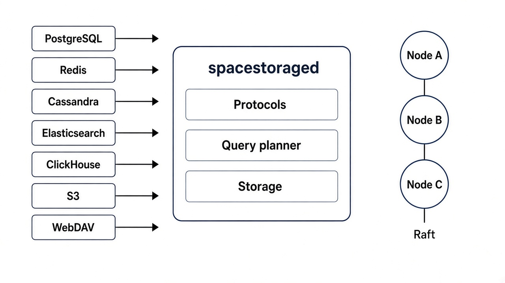
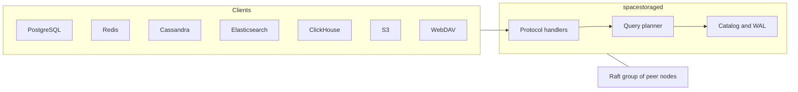
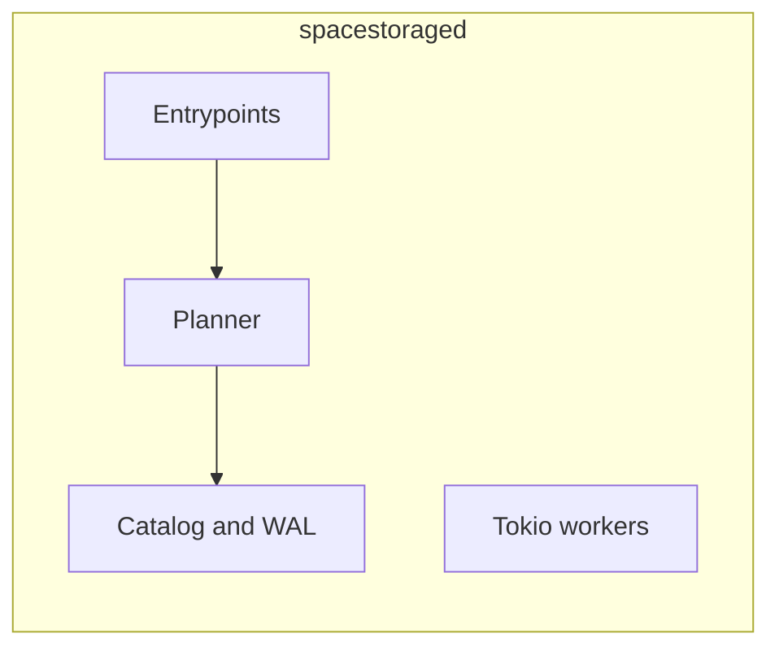
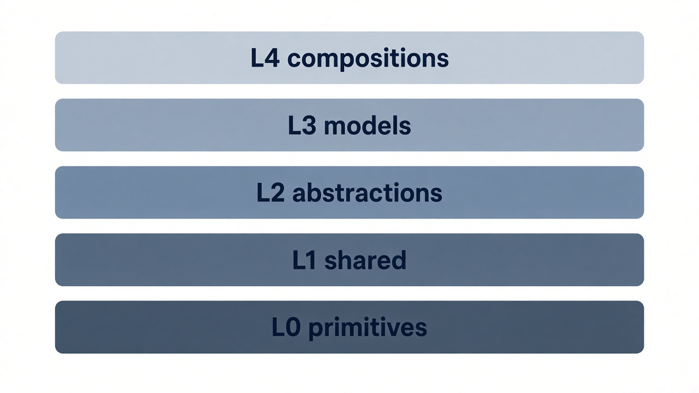
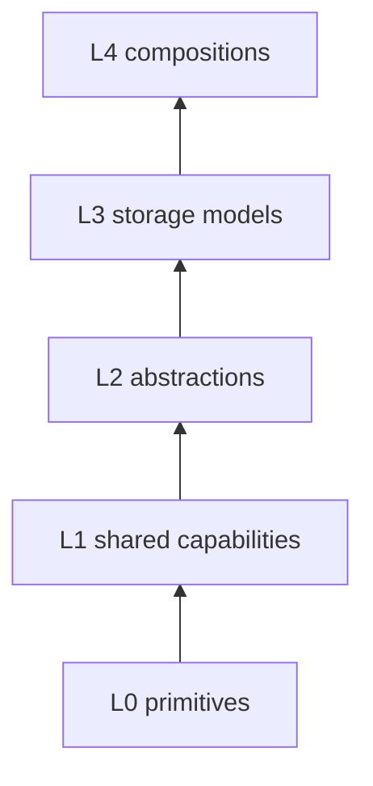

# Architecture

One async Tokio process owns the listeners, the planner, the catalog, and the local disks. Clustering adds nodes. It does not split the process into services.

## Clients, process, cluster

Handlers turn wire bytes into one `LogicalRequest` and call `PlannerEngine`. Execution records name `engine = "planner"`. A request moves `Received` → `Bound` → `Planned` → `Scheduled` → `Running` → `Finalizing` → `Done` (or `Failed` / `Cancelled`). `EXPLAIN` stops at `Planned`.

Admission runs before `Scheduled`: a node concurrency slot, then a namespace slot, then a memory reservation. A miss returns `admission_rejected` and does not wait. Spill, when enabled, covers sort, hash, and aggregation plans that exceed query memory. It does not buy an extra concurrent query.

## Inside one node

Listeners are the `entrypoint` blocks: admin TCP, admin HTTP, each client protocol, internode, and replication. Fsync and the same class of blocking durability run on a dedicated blocking pool, not on a Tokio worker. A write that counts toward quorum waits for that durability contract.

Admin HTTP is also where `/ui/*`, `/metrics`, and the `/v1/*` operator routes are mounted when the complete-product build is running.

## Datatype ladder

L3 models in the first binary include Relational Table, Document Store, and K/V Store. New models are new types, not a second engine. L0 creatable types and L4 planetary compositions are complete-product surfaces (`spacestorage l0`, `spacestorage composition`).

Isolation is a closed set: `READ COMMITTED` (default) and `SNAPSHOT` when the type is snapshot-capable. `SERIALIZABLE` is refused. Cassandra consistency is not rewritten into SQL isolation.

## Placement and time

A cluster declares an ordered topology ladder. The reserved farness keys are `rack`, `az`, `region`, `continent`, and `planet`. A given cluster uses a subsequence of that list. Every member supplies a value for each key on **that** ladder. `planet` is a label. It is not a voting set.

The voting set is `quorum_domain`. Write acknowledgement `TWO` counts durable replicas inside that domain. The product default is write `TWO`, read `ONE`. A one-node lab may set write `ONE` in `query_defaults`.

## Durability and control plane

Persistent data is a directory (`storage { data_dir }`) plus named drives. The write-ahead log lives with that data. Group commit is optional (`storage { group_commit { … } }`).

Namespace, quota, and role changes commit on the cluster Raft group. A minority does not apply them. Quota **usage** is spread between coordinators as best-effort deltas. The cap itself is the committed quota. Usage is not stored in the cluster log.

Raft timeouts are `cluster { raft { heartbeat; election_timeout; } }`. `election_timeout` must be greater than `heartbeat`.
